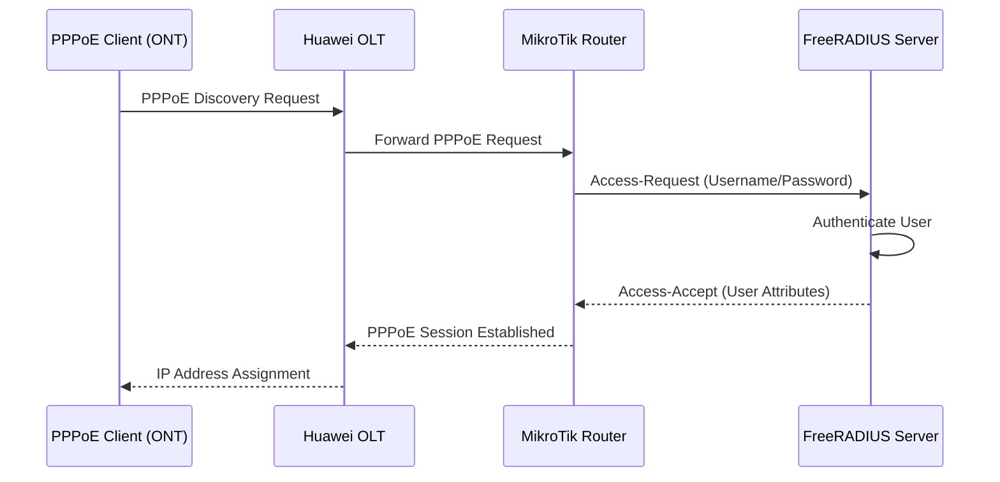
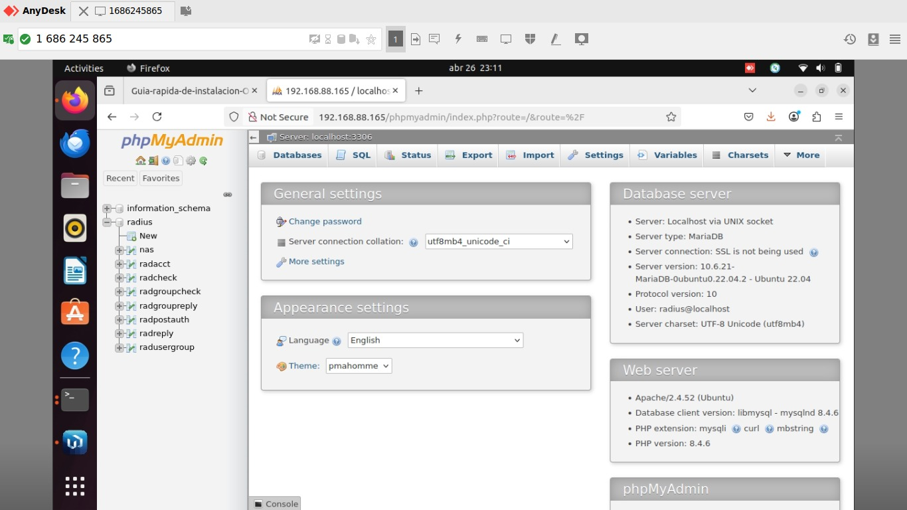

# FreeRADIUS Server Implementation for ISP Network Infrastructure

## Table of Contents

1. [Project Overview](#project-overview)
2. [FreeRADIUS Fundamentals](#freeradius-fundamentals)
3. [Network Architecture and Components](#network-architecture-and-components)
4. [Installation and Basic Configuration](#installation-and-basic-configuration)
5. [Database Integration with MySQL/MariaDB](#database-integration-with-mysqlmariadb)
6. [User Management and Group Policies](#user-management-and-group-policies)
7. [PPPoE Authentication Implementation](#pppoe-authentication-implementation)
8. [Huawei OLT Integration](#huawei-olt-integration)
9. [ONT Configuration and VLAN Management](#ont-configuration-and-vlan-management)
10. [Troubleshooting and Optimization](#troubleshooting-and-optimization)

## Project Overview

This documentation presents the comprehensive implementation of a FreeRADIUS authentication server within an ISP network infrastructure deployed in a university laboratory environment. The project demonstrates the integration of RADIUS-based Authentication, Authorization, and Accounting (AAA) services with optical network equipment, specifically focusing on GPON (Gigabit Passive Optical Network) technology using Huawei OLT (Optical Line Terminal) devices.

The implementation addresses the critical requirement for secure user authentication and network access control in modern ISP operations, utilizing PPPoE (Point-to-Point Protocol over Ethernet) as the primary authentication mechanism for end-user connectivity.

## FreeRADIUS Fundamentals

### AAA Protocol Overview

FreeRADIUS implements the RADIUS protocol, which provides a comprehensive AAA framework:

- **Authentication**: Verifies user identity through credential validation
- **Authorization**: Determines user access privileges and resource allocation
- **Accounting**: Records session data for billing and auditing purposes
- **Auditing**: Maintains logs for security and compliance monitoring

The RADIUS protocol operates over UDP, utilizing port 1812 for authentication and port 1813 for accounting services. Communication between RADIUS clients (Network Access Servers) and the RADIUS server employs Attribute-Value Pairs (AVPs) to exchange authentication and authorization data.

### Attribute-Value Pairs (AVPs)

AVPs constitute the fundamental data structure for RADIUS communication, categorized as:

- **Check Attributes**: Transmitted from client to server for validation
- **Reply Attributes**: Sent from server to client containing authorization parameters

### Vendor-Specific Attributes (VSAs)

VSAs enable equipment manufacturers to implement proprietary attributes while maintaining RADIUS protocol compatibility. For this implementation, Huawei and MikroTik VSAs are utilized for advanced network control features.

## Network Architecture and Components

### Network Topology

The implemented network architecture consists of the following components:

```
End User Devices → ONT → OLT (Huawei) → MikroTik Router → FreeRADIUS Server → Internet
```

### Key Network Elements

1. **ONT (Optical Network Terminal)**: Customer premises equipment providing fiber-to-Ethernet conversion
2. **OLT (Optical Line Terminal)**: Central office equipment managing multiple ONTs via GPON technology
3. **RADIUS Server**: Centralized authentication and authorization service
4. **MikroTik Router**: Network gateway providing PPPoE termination and IP address assignment

### Authentication Protocols

The implementation supports multiple authentication methods:

- **PAP (Password Authentication Protocol)**: Clear-text password transmission
- **CHAP (Challenge Handshake Authentication Protocol)**: Encrypted challenge-response authentication
- **MS-CHAP**: Microsoft's implementation of CHAP with enhanced security features

## Installation and Basic Configuration

### System Requirements

The FreeRADIUS server was deployed on Ubuntu 22.04 LTS with the following specifications:

- MariaDB database server for user data storage
- PHP and phpMyAdmin for database management
- Network connectivity to all RADIUS clients (NAS devices)

### Configuration File Structure

FreeRADIUS configuration files are located in `/etc/freeradius/3.0/`:

- **clients.conf**: Defines RADIUS clients (NAS devices) and shared secrets
- **users**: Contains user authentication and authorization policies
- **radiusd.conf**: Main server configuration file
- **sites-enabled/**: Directory containing active virtual server configurations

### Service Management Commands

```bash
service freeradius restart
service freeradius stop
radiusd -X
```

The debug mode (`radiusd -X`) provides detailed logging for troubleshooting authentication issues and configuration validation.

## Database Integration with MySQL/MariaDB

### Database Schema Implementation

The implementation utilizes MySQL/MariaDB as the backend database for scalable user management. The database schema includes the following primary tables:

#### Core RADIUS Tables

1. **radcheck**: Stores authentication credentials and check conditions
2. **radreply**: Contains authorization attributes returned after successful authentication
3. **radacct**: Records accounting data for session tracking
4. **radusergroup**: Maps users to groups for attribute inheritance
5. **radgroupcheck**: Defines group-level check conditions
6. **radgroupreply**: Specifies group-level reply attributes

#### Database Connection Configuration

The database configuration establishes secure connectivity between FreeRADIUS and the MySQL backend, enabling dynamic user authentication and real-time attribute assignment.

### SQL Module Activation

Database integration requires activating the SQL module through symbolic linking:

```bash
sudo ln -s /etc/freeradius/3.0/mods-available/sql /etc/freeradius/3.0/mods-enabled/
```

This command enables FreeRADIUS to utilize MySQL for authentication queries, replacing file-based user management with scalable database operations.

## User Management and Group Policies

### User Groups and Profiles

The implementation employs a hierarchical user management system utilizing groups and profiles for efficient attribute management:

#### Group-Based Attribute Assignment

Groups categorize users with similar access requirements, enabling centralized policy management. Each group defines:

- **Bandwidth limitations**: Upload and download rate restrictions
- **VLAN assignments**: Network segmentation parameters
- **Session timeouts**: Maximum connection duration
- **IP pool assignments**: Address allocation policies

#### User Profile Implementation

User profiles provide template-based configuration for users without individual database entries. Profiles are assigned using the `User-Profile` internal attribute within the `radcheck` table.

### Database Table Relationships

| Table           | Purpose                   | Key Attributes                             |
| --------------- | ------------------------- | ------------------------------------------ |
| `radcheck`      | Authentication validation | `Cleartext-Password`, `User-Profile`       |
| `radreply`      | Authorization parameters  | `Framed-IP-Address`, `Mikrotik-Rate-Limit` |
| `radusergroup`  | Group membership mapping  | User-to-group associations                 |
| `radgroupreply` | Group-level attributes    | Shared authorization parameters            |

## PPPoE Authentication Implementation

### PPPoE Protocol Overview

PPPoE (Point-to-Point Protocol over Ethernet) encapsulates PPP frames within Ethernet, enabling multiple users on a single network segment to establish individual authenticated sessions. The protocol operates in two phases:

1. **Discovery Phase**: Client identifies available PPPoE servers and establishes session parameters
2. **Session Phase**: Authenticated PPP connection for data transmission

### Authentication Flow



### AAA Domain Configuration

The OLT configuration establishes authentication domains linking PPPoE sessions to RADIUS servers:

```
aaa

authentication-scheme newscheme
authentication-mode radius
quit

accounting-scheme newscheme
accounting-mode radius
quit

radius-server template hwtest
radius-server authentication 192.168.50.10 1812
radius-server accounting 192.168.50.10 1813
quit

aaa
domain isp
authentication-scheme newscheme
accounting-scheme newscheme
radius-server hwtest
quit
```

### User Credential Management

FreeRADIUS credentials are configured for different service tiers:

```
username = plan100 ; password = pass100
username = plan200 ; password = pass200
```

## Huawei OLT Integration

### SSH Configuration

Secure Shell (SSH) access to the Huawei OLT enables remote management and configuration. The following commands establish SSH connectivity:

```
enable
config
sysman service ssh disable
display ssh server status
display ssh user-information
display ssh server session
ssh sftp clear
sysman service ssh enable
save
```

#### Command Analysis

1. **`enable`**: Enters privileged mode for administrative operations
2. **`config`**: Accesses system configuration mode
3. **`sysman service ssh disable/enable`**: Controls SSH service state
4. **`display ssh server status`**: Verifies SSH service configuration
5. **`display ssh user-information`**: Lists configured SSH users and authentication methods
6. **`display ssh server session`**: Shows active SSH connections

### Service Port Management

The OLT manages customer connections through service ports, which map ONTs to VLANs:

```
display service-port all
```

Service port removal commands:

```
undo service-port 500
undo ont-lineprofile gpon profile-id 500
```

### ONT Information Queries

```
display ont info 0
display ont info by-sn 485754436B886FA5
```

These commands provide detailed ONT status including optical power levels, registration status, and service configuration.

## ONT Configuration and VLAN Management

### Dynamic Bandwidth Allocation (DBA) Profiles

DBA profiles manage upstream bandwidth allocation for optimal network performance:

#### DBA Profile Types

1. **Fixed**: Constant guaranteed bandwidth allocation
2. **Assured**: Minimum guaranteed bandwidth with dynamic expansion
3. **Non-Assured**: Best-effort bandwidth without guarantees
4. **Best-Effort**: Lowest priority, utilizing available resources

#### Configuration Parameters

- **CIR (Committed Information Rate)**: Guaranteed minimum bandwidth
- **PIR (Peak Information Rate)**: Maximum allowable bandwidth
- **Priority**: Traffic precedence during network congestion

Example DBA profile configuration:

```bash
dba-profile add profile-name "DBA_VOIP" type3 assure 10240 max 20480
```

### ONT Operating Modes

#### Bridge Mode vs Router Mode Comparison

| Characteristic           | Bridge Mode                            | Router Mode (PPPoE Client)                      |
| ------------------------ | -------------------------------------- | ----------------------------------------------- |
| **Primary Function**     | Layer 2 optical-to-Ethernet conversion | Integrated router with PPPoE, NAT, and firewall |
| **PPPoE Client**         | End-user router                        | ONT device                                      |
| **Public IP Assignment** | User's router                          | ONT device                                      |
| **NAT Implementation**   | User's router responsibility           | ONT internal NAT                                |
| **User Control**         | Full router selection freedom          | Limited to ONT configuration                    |
| **LAN Network**          | No internal LAN                        | Private LAN (e.g., 192.168.1.0/24)              |

#### Router Mode Configuration

In router mode, the ONT establishes PPPoE authentication using configured credentials, creating a private LAN for connected devices while performing NAT translation to the assigned public IP address.

The WAN status indicator confirms successful authentication against the FreeRADIUS server, enabling internet connectivity for downstream devices.

### IP Address Assignment Process

PPPoE authentication with FreeRADIUS follows this sequence:

1. **Pool Definition**: FreeRADIUS defines IP pools for different service plans
2. **Authentication**: ONT authenticates using PPPoE credentials
3. **Pool Assignment**: MikroTik router assigns IP from appropriate pool based on user group
4. **Session Establishment**: Authenticated session enables internet access

#### Network Flow Diagram

```
User Devices → ONT (PPPoE Client + NAT) → OLT (Layer 2) → MikroTik (Public IP Assignment) → Internet
```

### MikroTik RADIUS Integration

RADIUS client configuration on MikroTik router:

```
/radius
add service=login address=192.168.50.10 secret=Seguridad123 timeout=10s
```

## Troubleshooting and Optimization

### Common Issues and Solutions

#### Port 1812 Address Conflict

**Problem**: FreeRADIUS fails to bind to authentication port
**Error Message**: "Failed binding to auth address \* port 1812... Address already in use"

**Solution Process**:

1. **Identify Process Using Port**:

```bash
sudo lsof -iUDP:1812
sudo netstat -anu | grep 1812
```

2. **Terminate Conflicting Process**:

```bash
sudo kill -9 [PID]
sudo pkill freeradius
```

3. **Restart Service**:

```bash
sudo systemctl restart freeradius
sudo systemctl status freeradius
```

### Database Performance Optimization



The phpMyAdmin interface provides comprehensive database management capabilities, enabling administrators to monitor user sessions, modify group policies, and analyze authentication logs for network optimization.

### Service Verification Commands

**ONT IP Configuration**:

```
interface gpon 0/1
EA5800-X2(config-if-gpon-0/1)#ont ipconfig 0 0 pppoe vlan 13 priority dscp-mapping 3 user-account username
```

This command configures ONT-specific PPPoE parameters including VLAN assignment and QoS marking for traffic prioritization.

## Conclusion

The implementation of FreeRADIUS within the ISP network infrastructure demonstrates the successful integration of centralized authentication services with modern optical networking equipment. The solution provides scalable user management, flexible authorization policies, and comprehensive accounting capabilities essential for ISP operations.

Key achievements include:

- **Centralized Authentication**: Single point of user credential management
- **Dynamic Authorization**: Real-time attribute assignment based on user groups
- **Network Segmentation**: VLAN-based traffic isolation and QoS implementation
- **Scalable Architecture**: Database-driven configuration supporting growth
- **Comprehensive Monitoring**: Detailed logging and session tracking capabilities

The documented procedures and configurations provide a foundation for production ISP deployments, demonstrating the practical application of RADIUS technology in fiber-optic access networks.
